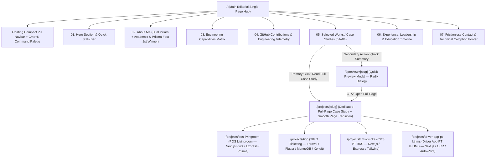

# Product Requirements Document (PRD)
## Personal Portfolio Website — Aryo Ristiawan Machfudz

| Metadata | Detail |
| :--- | :--- |
| **Document Owner** | Aryo Ristiawan Machfudz |
| **Role Positioning** | Full-Stack Developer, System Analyst & API Architect (Software Engineering Student, IPB University — GPA 3.83/4.00) |
| **Target Framework** | Next.js 16 (App Router), React 19, TypeScript 5, Tailwind CSS v4 |
| **Motion Stack** | Lenis Smooth Scroll, GSAP + ScrollTrigger, Motion (Framer Motion), Radix UI Primitives |
| **Design Paradigm** | Editorial Technical Portfolio ("Anti-AI Slop"), Swiss Grid, Emil Kowalski Micro-Interactions |
| **Primary Language** | Full English (Tone: *Pragmatic Engineer* — concise, architectural, impact-driven) |
| **Reference Benchmarks** | [rinlayheang.me](https://rinlayheang.me) (Editorial layout, crisp metrics, technical storytelling) & [sausanasma.vercel.app](https://sausanasma.vercel.app) (Dedicated `/projects/[slug]` pages, smooth section/page transitions, IPB TRPL dual-role positioning, GitHub telemetry) |
| **Status** | Approved Specification (v1.2 — Multi-Route Case Studies, Smooth Section Transitions & GitHub Contributions) |

---

## 1. Product Vision & Brand Identity

### 1.1 Executive Summary & Vision Statement
Build an authoritative, interactive, and editorially refined personal portfolio for **Aryo Ristiawan Machfudz**—a third-year Software Engineering student at **IPB University (GPA 3.83/4.00)** specializing in **Full-Stack Web & Mobile Development, System Analysis, and API Architecture**.

Guided by Aryo's core philosophy—**"Technology builds the solution. Operations deliver the impact."**—and informed by reference benchmarks [rinlayheang.me](https://rinlayheang.me) and [sausanasma.vercel.app](https://sausanasma.vercel.app), this platform combines:
1. **High-Signal Editorial Storytelling**: Crisp metrics, architectural diagrams, and dual-discipline positioning (*Full-Stack Engineering + System Analysis & High-Scale Operations*).
2. **Dedicated Multi-Page Project Case Studies (`/projects/[slug]`) + Quick Preview Modal**: Giving every flagship project its own deep-dive architectural page with seamless route transitions, alongside an instant quick-preview modal on the main page.
3. **Choreographed Section-to-Section Transitions**: Fluid scroll-driven transitions between sections powered by **Lenis** and **GSAP ScrollTrigger**.
4. **Live Engineering Telemetry (GitHub Contributions Section)**: Interactive 52-week contribution heatmap, language distribution, and commit activity metrics.

### 1.2 Target Audience & Jobs-to-be-Done (JTBD)
1. **Tech Recruiters & Hiring Managers (Global & National Tech Companies)**
   - *Need*: Quickly verify technical depth, real-world quantifiable metrics (`<2s` QR check-in, `70%` faster CMS publishing, `60%` faster driver trip reporting, `25%` faster client onboarding), academic excellence (`3.83/4.00 GPA` at IPB University), competition wins (`1st Winner Prisma Fest 2025`), and leadership maturity (`GDGoC IPB Technical Core Team`, `IT Festival 2025 Vice Head of Competition`).
2. **Engineering Leads & Senior Architects**
   - *Need*: Inspect dedicated project pages (`/projects/[slug]`) to evaluate how Aryo approaches system design, relational & NoSQL database modeling (`PostgreSQL`, `MySQL`, `MongoDB`, `Prisma ORM`), API orchestration (`Xendit` webhooks, `Google OAuth`, `WhatsApp API`, `OCR` pipelines, direct `Web-to-Printer` integration), and consistent coding activity via the **GitHub Contributions** section.
3. **Prospective Enterprise/SME Clients & Founders**
   - *Need*: See live, battle-tested proof of end-to-end delivery across B2B and operational domains (Ship Management CMS at `bks-shipmanagement.com`, PWA Retail POS at `living-room-icecream.vercel.app`, Logistics Trip & Driver Management, and Event Ticketing Ecosystems).

### 1.3 Brand Persona & Tone of Voice
- **Archetype**: *The Pragmatic Systems Engineer*
- **Voice Attributes**:
  - **Evidence-Based & Metric-Driven**: Every project and experience claim is anchored by concrete metrics from Aryo's track record (`99.9%` uptime, `70%` faster publishing, `60%` reduction in manual driver submission time, `< 2s` QR check-in, `150+` competition teams managed).
  - **Architectural**: Emphasize *why* a technical decision was made (trade-offs, schema design, webhook idempotency, hardware/printer integration) alongside *what* was built.
  - **Editorial Precision**: Crisp sentences, active verbs, scannable bullet points, and monospace metadata markers.

### 1.4 The "Anti-AI Slop" Manifesto (Strict Design Guardrails)
To distinguish this portfolio from auto-generated templates and generic AI landing pages, the following rules are strictly enforced:

| Forbidden ("AI Slop" Antipatterns) | Mandatory ("Editorial Craft" Standard) |
| :--- | :--- |
| Neon purple/cyan/magenta radial glows (`blur-3xl` gradients floating in the background) | High-contrast architectural surfaces (`Deep Carbon #0C0C0C` / `Warm Alabaster #F7F6F2`) separated by crisp `1px` structural hairlines |
| Cheap glassmorphism cards with heavy drop shadows and rainbow borders | Flat or subtly elevated tactile surfaces with deliberate border luminance transitions (`border-subtle` -> `border-strong`) |
| Meaningless floating 3D blobs, astronauts, or looping Lottie animations | Purposeful system architecture diagrams, interactive GitHub contribution telemetry, and authentic product UI mockups |
| Arbitrary skill percentage bars (e.g., *"Next.js 90%, Laravel 85%"*) | Contextual **Architectural Capability Matrix** linking each technology directly to shipped systems (`TIGO`, `POS Livingroom`, `PT BKS`, `PT KJHMS`, `Matra Hillindo`) |
| Generic marketing buzzwords (*"Unleash the power of next-gen digital experiences"*) | Direct engineering statements backed by real system metrics, role ownership, and operational context |
| Abrupt page jumps or sluggish over-animated transitions (`duration > 600ms`) | Choreographed section-to-section reveals, smooth route transitions (`/projects/[slug]`), and Emil Kowalski-style spring physics (`stiffness: 380, damping: 32`) |

---

## 2. Sitemap, Routing Architecture & Section Breakdown

### 2.1 High-Level Information & Routing Architecture
Inspired by [sausanasma.vercel.app](https://sausanasma.vercel.app) and [rinlayheang.me](https://rinlayheang.me), the application uses a **Hybrid Multi-Route Editorial Architecture**:
- **Main Editorial Hub (`/`)**: A choreographed 7-section scrollytelling experience with smooth section-to-section transitions and an optional **Quick Preview Modal** (`/?preview=[slug]`) for rapid inspection.
- **Dedicated Project Case Study Pages (`/projects/[slug]`)**: Each of the 4 flagship projects has its own standalone, deep-dive engineering page accessible via smooth route transitions, complete with sticky Table of Contents, interactive Architecture Blueprint, UI showcase, and Next/Previous project navigation.



---

### 2.2 Global Navigation & Command Bar
1. **Top Header Strip (Editorial Masthead)**:
   - Left: Monospace identity mark (`ARYO R. MACHFUDZ // BOGOR, ID`) + Live local time in `UTC+7 (WIB)` updated every second with `tabular-nums`. On `/projects/[slug]` pages, displays an interactive `<- Back to Index` breadcrumb button with spring arrow shift.
   - Right: Availability indicator pill (`● Available for Internships & Engineering Projects`), Theme Toggle (`Dark / Light`), and `Cmd+K` trigger badge.
2. **Floating Compact Navigation Pill (Bottom-Center on Mobile, Sticky Top-Center on Desktop)**:
   - Links: `Index`, `About`, `Skills`, `GitHub`, `Works (04)`, `Timeline`, `Contact`.
   - Active section indicator smoothly morphs across nav items using Motion's `layoutId="active-nav-pill"` synchronized with GSAP ScrollTrigger section tracking.
3. **Command Palette (`Cmd+K` / `Ctrl+K`)**:
   - Instant keyboard navigation to jump to any section on `/`, navigate directly to any dedicated project page (`/projects/pos-livingroom`, `/projects/tigo`, `/projects/cms-pt-bks`, `/projects/driver-app-pt-kjhms`), launch live deployments (`bks-shipmanagement.com`, `living-room-icecream.vercel.app`), copy `machfudzaryo@gmail.com`, download Official CV PDF, or toggle Dark/Light theme.

---

### 2.3 Section 01: Hero Section & Quick Stats
**Design Intent**: Establish immediate authority through editorial typography, structural grid lines, and quantifiable proof of work—without relying on an oversized portrait photo.

- **Layout**: 12-column Swiss editorial grid framed by exposed `1px` vertical and horizontal rules.
- **Top Metadata Row**:
  - `SECTION // 01 — INDEX`
  - Role tag: `FULL-STACK DEVELOPER · SYSTEM ANALYST · API ARCHITECT`
  - Academic & Honors tag: `IPB UNIVERSITY (RPL) · 1ST WINNER PRISMA FEST 2025`
- **Primary Statement Headline**:
  - Mixed typography combining `Geist Sans` (Tight tracking `-0.035em`, Medium) with `Instrument Serif Italic` on key conceptual words:
  - *"Technology builds the *solution*. Operations deliver the *impact*."*
- **Sub-headline (Pragmatic Bio Summary)**:
  - *"I'm Aryo Ristiawan Machfudz—a third-year Software Engineering student at IPB University (3.83 GPA) specializing in Full-Stack Web & Mobile Development, System Analysis, and API Architecture. Experienced in shipping end-to-end digital platforms—from custom corporate CMS and OCR-assisted driver dispatch systems to PWA point-of-sale and Xendit-powered ticketing ecosystems."*
- **Primary Action Bar**:
  - **Primary CTA**: `Explore Selected Works ↓` (High-contrast fill button that smoothly scrolls to Section 05 via Lenis).
  - **Secondary CTA**: `Download Resume (PDF) ↗` (Monospace-accented ghost button).
  - **Quick Copy Action**: Inline interactive email chip (`machfudzaryo@gmail.com`) with one-click copy & icon morph.
- **Quick Stats Bar (4-Column Hairline Grid at Bottom of Hero)**:
  Each cell features a monospace index, a large tabular metric (`clamp(1.75rem, 3vw, 2.5rem)`), and a concise contextual label:
  1. `STAT // 01` — **`3.83`** `/ 4.00` | **Academic GPA at IPB University** *(3rd-Year Software Engineering Undergraduate, Expected Jun 2028)*
  2. `STAT // 02` — **`04+`** `Systems` | **End-to-End Production Architectures** *(Shipped across Maritime CMS, Logistics OCR, Retail POS & Event Ticketing)*
  3. `STAT // 03` — **`1st`** `Winner` | **Prisma Fest Web Design 2025** *(National Competition Winner at UIN Sunan Ampel Surabaya)*
  4. `STAT // 04` — **`150+`** `Teams` | **Technical & Competition Operations** *(GDGoC IPB Technical Core Team & Vice Head of Competition IT Fest)*

---

### 2.4 Section 02: About Me (Complementary Strengths & Featured Honors)
**Design Intent**: Translate Aryo's portfolio executive summary into a sharp editorial narrative that highlights his two complementary pillars—**Technical Software Development** and **High-Scale Technical Operations**—plus a dedicated spotlight card for his national competition win.

- **Layout**: Asymmetric 2-column layout (`5 cols` sticky identity, education coursework & honors card on left; `7 cols` dual-pillar narrative & system analysis methodology on right).
- **Core Narrative — Dual Complementary Pillars**:
  1. **`PILLAR 01 // TECHNICAL SOFTWARE DEVELOPMENT`**:
     - Bridging business requirements with clean, high-performance code across React, Next.js, Laravel, Node.js, Express.js, and Flutter.
     - Designing normalized relational (`PostgreSQL`, `MySQL`, `Prisma ORM`) and document (`MongoDB`) schemas, automated payment webhooks (`Xendit`), and hardware/API bridges (`OCR`, `WhatsApp API`, `Web-to-Printer`).
  2. **`PILLAR 02 // HIGH-SCALE COMPETITION & TECHNICAL OPERATIONS`**:
     - Leading technical education as **GDGoC IPB Technical Core Team** (mentoring bootcamp engineers, designing national competition code rubrics) and orchestrating governance for **150+ teams** and **10+ industry judges** as **Vice Head of Competition at IT Festival 2025**.
- **Academic & Honours Card (Left Column Highlight)**:
  - **Education**: IPB University — Software Engineering (`Aug 2024 – Jun 2028 Expected`), **GPA: 3.83/4.00**.
  - **Key Coursework Pills**: `Data Structures & Algorithms`, `Database Systems & Architecture`, `Web & Mobile App Dev`, `Software Engineering Principles`, `Software Quality Assurance`, `AR Systems`.
  - **Featured Honors Spotlight**: **1st Winner — Prisma Fest Web Design Competition (2025)**, UIN Sunan Ampel Surabaya *(Featured Project: Lumind — Digital Mental Wellness Platform)*.

---

### 2.5 Section 03: Engineering Skills (Architectural Capability Matrix)
**Design Intent**: Present Aryo's complete technical toolkit from his CV & Portfolio in a structured **4-Domain Architectural Capability Matrix** that maps every tool to real production deliverables (zero percentage bars).

- **Layout**: 4-Row Architectural Grid with `1px` borders. Hovering or focusing on any technology pill highlights the linked production projects where it was deployed.

| Domain Code | Domain Title | Core Technologies & Tools | Production Context & Applied Usage |
| :--- | :--- | :--- | :--- |
| **`DOM // 01`** | **Frontend & UI Engineering** | `JavaScript`, `TypeScript`, `Next.js`, `React`, `Tailwind CSS`, `Shadcn UI`, `Mantine UI`, `Chart.js`, `Figma` | Engineered `15+` responsive web templates (`Matra Hillindo`), PWA analytics dashboards (`POS Livingroom`), corporate CMS UI (`PT BKS`), and real-time *Grafik Ritase* dashboards (`PT KJHMS`). |
| **`DOM // 02`** | **Backend & API Architecture** | `Node.js`, `Express.js`, `PHP`, `Laravel`, `Python`, `RESTful APIs`, `Google OAuth` | Built transactional retail POS APIs (`POS Livingroom`), multi-role event ticketing backends (`TIGO`), and high-uptime (`99.9%`) CMS endpoints (`PT BKS`). |
| **`DOM // 03`** | **Database Systems & Cloud Media** | `PostgreSQL`, `MySQL`, `MongoDB`, `Prisma ORM`, `Cloudinary`, `Vercel`, `Git`, `Postman` | Designed relational schemas with `Prisma ORM` (`POS Livingroom`), structured NoSQL `MongoDB` collections (`TIGO`), and managed cloud media & edge deployments (`Cloudinary`, `Vercel`). |
| **`DOM // 04`** | **Mobile & Specialized Integrations** | `Flutter`, `Xendit Payment Gateway`, `OCR Extraction`, `Web-to-Printer API`, `WhatsApp API`, `QR Scanner (RBAC)` | Built `<2s` RBAC QR check-in mobile apps (`TIGO`), real-time Xendit webhook listeners, automated OCR receipt parsers & SIJ auto-printing (`PT KJHMS`), and dynamic WhatsApp invitation forwarders (`Matra Hillindo`). |

---

### 2.6 Section 04: GitHub Contributions & Engineering Telemetry
**Design Intent**: Inspired by modern developer portfolios like `sausanasma.vercel.app`, provide live, verifiable proof of consistent coding activity, repository contributions, and language distribution in an editorial telemetry block that harmonizes with the portfolio's color system.

- **Layout**: 12-column framed architectural telemetry panel directly below the Capability Matrix (`SECTION // 04 — OPEN SOURCE & COMMIT TELEMETRY`).
- **Component Breakdown**:
  1. **Top Telemetry Header Bar**:
     - Left: Monospace title `GITHUB ACTIVITY // LIVE COMMIT TELEMETRY` + Direct profile badge (`@aryomcz` / configurable via `NEXT_PUBLIC_GITHUB_USERNAME`).
     - Right: Year filter pills (`2026`, `2025`, `2024`) with smooth active indicator (`layoutId="github-year-pill"`).
  2. **Interactive 52-Week Contribution Heatmap Grid**:
     - Renders 52 columns (weeks) × 7 rows (days) of contribution cells.
     - **Custom Editorial Color Mapping**: Uses 5 semantic intensity levels (`--gh-level-0` through `--gh-level-4`) tailored for Dark Mode (`#161615` -> `#FF4F00` or `#10B981` toggleable) and Light Mode (`#E8E5DC` -> `#D93800` / `#059669`), avoiding garish default colors.
     - **Micro-Interaction**: Hovering or focusing on any day cell scales it subtly (`scale: 1.25`) and displays a floating spring-animated tooltip: `"[N] contributions on [Day, DD MMM YYYY]"`.
  3. **Bottom Telemetry Summary Strip (4 Metric Cells + Language Distribution Bar)**:
     - **Total Annual Contributions** (Tabular monospace counter, e.g., `640+ Contributions in 2025–2026`).
     - **Primary Stack Distribution Bar**: Segmented horizontal hairline bar showing proportional usage: `TypeScript (42%)`, `JavaScript (24%)`, `PHP / Laravel (18%)`, `Dart / Flutter (16%)`.
     - **Active Repositories / Production Deployments**: `12+ Public & Client Repositories` across Vercel, GitHub, and Campus Ecosystems.
     - **Direct CTA**: `View GitHub Profile ↗` button.
  4. **Data Fetching & Resilience Strategy**:
     - Fetched via Next.js Server Component / Route Handler using `github-contributions-api` or GitHub GraphQL API with **ISR caching (`revalidate: 3600` — 1 hour)**.
     - Includes a deterministic, realistic **Static Fallback Snapshot** so the heatmap renders instantaneously with zero layout shift even when offline or rate-limited.

---

### 2.7 Section 05: Selected Works / Case Studies (Dedicated `/projects/[slug]` Pages + Quick Preview Modal)
**Design Intent**: Combine the best of [sausanasma.vercel.app](https://sausanasma.vercel.app) (dedicated full-page case study routes `/projects/[slug]` with smooth transitions) and [rinlayheang.me](https://rinlayheang.me) (high-signal numbered editorial cards + quick preview modal).

#### 2.7.1 Main Page Card Anatomy (Editorial Showcase Row `01`–`04`)
Each of the 4 project cards spans the full 12-column container on `/`, separated by crisp horizontal dividers:
- **Left Column (5 Cols — Editorial Metadata & Narrative)**:
  - Monospace Index + Year + Project Type: e.g., `01 // 2026 · CAMPUS & CLIENT PWA SYSTEM`
  - Project Title (`Geist Sans`) + Contextual Subtitle in `Instrument Serif Italic`
  - Role Badge: Exact role from CV
  - **Executive Summary (2 sentences)**: The business bottleneck and the engineered solution.
  - **Verified Impact Metric Pill**: High-signal metric in `Geist Mono` with emerald/vermilion status dot.
  - **Tech Stack Tags**: Compact monospace pills.
  - **Dual Action Row**:
    1. **Primary CTA**: `Read Full Case Study ->` (Navigates to `/projects/[slug]` with smooth page transition).
    2. **Secondary CTA**: `Quick Preview [⊞]` (Opens the instant in-place Quick Preview Modal `/?preview=[slug]`).
    3. **External Link (if public)**: `Live Site ↗` (`living-room-icecream.vercel.app` or `www.bks-shipmanagement.com`).
- **Right Column (7 Cols — Authentic Device & UI Preview Frame)**:
  - Clicking the visual preview frame navigates directly to `/projects/[slug]` with a coordinated hover zoom (`scale: 1.015`) and cursor badge `"View Case Study"`.

---

#### 2.7.2 Dedicated Project Page Architecture (`/projects/[slug]`)
When a user navigates to `/projects/pos-livingroom`, `/projects/tigo`, `/projects/cms-pt-bks`, or `/projects/driver-app-pt-kjhms`, they enter a comprehensive, standalone engineering publication page:

1. **Page Transition Choreography**:
   - Outgoing page fades/translates smoothly while the incoming `/projects/[slug]` page reveals its Hero header, resets scroll to `(0, 0)` via Lenis, and staggers in the metadata grid.
2. **Case Study Hero Header**:
   - Top Breadcrumb: `<- Back to All Works (/)` + Project Index (`CASE STUDY // 01 OF 04`).
   - Full Title, Subtitle, and **Verified Impact Banner** (3 key quantifiable metrics in large tabular numerals).
   - **Metadata Strip (4 Columns)**: `Role`, `Client / Organization`, `Timeline / Year`, `Live Deployment / Status`.
3. **2-Column Editorial Case Study Body**:
   - **Left Sticky Sidebar (`3 Cols` on Desktop)**:
     - Interactive **Table of Contents (TOC)** tracking active subsections (`01. Overview & Problem`, `02. System Analysis & Schema`, `03. Architecture Blueprint`, `04. Engineering Execution`, `05. Impact & Results`).
     - Full Tech Stack breakdown grouped by layer (`Frontend`, `Backend`, `Database`, `Integrations`).
     - Quick Action buttons (`Visit Live Production Site ↗` / `Quick Share Link`).
   - **Right Deep-Dive Content (`9 Cols` on Desktop)**:
     - **01 // Business Context & Operational Bottleneck**: Detailed breakdown of the real-world problem before Aryo's intervention.
     - **02 // System Analysis & Data Modeling**: Requirements engineering, actor workflows, and relational/NoSQL schema structures.
     - **03 // Interactive System Architecture Blueprint**: Custom HTML/SVG architectural flow diagram illustrating how requests move across Client, REST API, Database, and Third-Party Integrations (Xendit, OCR, Printer, Cloudinary).
     - **04 // Key Engineering Decisions & Feature Highlights**: Deep dive into specific technical implementations (e.g., Chart.js multi-period aggregation, Flutter RBAC QR scanner, Web-to-Printer SIJ dispatch, Express/Prisma transactions).
     - **05 // Quantifiable Impact & Operational Outcomes**: Before-vs-After comparison table and verified metrics.
4. **Bottom Next / Previous Project Navigation Strip**:
   - Full-width editorial footer card allowing seamless progression to the next case study (`01 POS Livingroom` -> `02 TIGO` -> `03 CMS PT BKS` -> `04 Driver App PT KJHMS` -> `01`) without returning to the home page.

---

#### 2.7.3 Flagship Case Studies Content Specification (`01`–`04`)

##### Project `01`: Point of Sale System for an Ice Cream Shop — Livingroom (`POS Livingroom`)
- **Dedicated Route**: `/projects/pos-livingroom`
- **Year & Category**: `2026` · PWA Point of Sale & Sales Analytics System
- **Role**: `Full-Stack Developer & System Analyst`
- **Live URL**: [living-room-icecream.vercel.app](https://living-room-icecream.vercel.app)
- **Core Stack**: `Next.js (PWA)`, `Node.js`, `Express.js`, `Prisma ORM`, `PostgreSQL / MySQL`, `Shadcn UI`, `Chart.js`, `Cloudinary`
- **Key Verified Metrics**:
  - `100%` Digitized Cashier Transaction Logging (Zero Manual Log Errors)
  - `4+` Dynamic Reporting Windows (`Minggu`, `1 Bulan`, `3 Bulan`, `6 Bulan` & Custom Date Picker)
  - `Real-Time` Top-Selling SKU Ranking (*Kul-kul*, *1 Scoop*, *Muffle*) for Inventory Decisions
- **Core Engineering Highlights**:
  - Conducted client requirements analysis to digitize manual cashier logs, eliminating human logging errors and streamlining store operations.
  - Designed relational database schemas and RESTful API endpoints using **Node.js**, **Express.js**, and **Prisma ORM** for reliable transaction tracking.
  - Built an installable **PWA frontend** and interactive admin dashboard featuring sales visualization charts (**Chart.js**), tracking *Total Items Terjual*, *Total Pendapatan*, and *Rata-Rata Pendapatan*.

##### Project `02`: TIGO (Ticket on the Go) — IPB University
- **Dedicated Route**: `/projects/tigo`
- **Year & Category**: `2026` · Full-Stack & Mobile Event Ticketing Ecosystem
- **Role**: `Full-Stack & Mobile Developer`
- **Core Stack**: `Laravel (REST API)`, `Flutter (Mobile)`, `React (Web)`, `MongoDB (NoSQL)`, `Xendit Payment Gateway`, `Google OAuth`, `Cloudinary`
- **Key Verified Metrics**:
  - `< 2s` Attendee Gate Check-In Time via Flutter Camera QR Scanner
  - `100%` Automated Payment Reconciliation via Real-Time Xendit Webhooks
  - `Dual-Platform` Ecosystem (Event Organizer Web Dashboard + Cross-Platform Flutter Mobile App)
- **Core Engineering Highlights**:
  - Architected an end-to-end event ticketing ecosystem comprising an event organizer web dashboard and a cross-platform **Flutter** mobile application.
  - Structured NoSQL **MongoDB** database schemas and built **Laravel** RESTful APIs with **Google OAuth** and **Cloudinary** integration for scalable media management.
  - Integrated **Xendit** payment gateway with real-time webhook listeners to process ticket transactions and automated ledger updates instantly.
  - Developed a camera-based **QR code scanner in Flutter** with **Role-Based Access Control (RBAC)**, enabling event staff to process attendee check-ins in under 2 seconds.

##### Project `03`: Company Profile & CMS Website — PT Bahtera Khatulistiwa Shipping (`PT BKS`)
- **Dedicated Route**: `/projects/cms-pt-bks`
- **Year & Category**: `2026` · Freelance Enterprise Web Platform & Custom CMS
- **Role**: `Product Developer (Full-Stack & System Analyst)`
- **Live URL**: [www.bks-shipmanagement.com](https://www.bks-shipmanagement.com)
- **Core Stack**: `Next.js`, `Tailwind CSS`, `Express.js (REST API)`, `Cloudinary`, `Figma`, `Vercel`
- **Key Verified Metrics**:
  - `70%` Faster Internal Corporate Content Publishing & Management
  - `99.9%` Production Uptime & Optimal Edge Performance on Vercel
  - `Full` Legacy Static-to-Dynamic CMS Migration for Ship Management Operations
- **Core Engineering Highlights**:
  - Modernized the corporate web platform for PT Bahtera Khatulistiwa Shipping by transitioning a legacy static site into a dynamic web application powered by a custom CMS.
  - Designed and implemented responsive, modern UI components using **Next.js** and **Tailwind CSS** (designed in **Figma**), improving site loading speed and digital brand positioning.
  - Built an intuitive back-office CMS dashboard empowering non-technical internal teams to manage fleet, exhibition, and career content 70% faster.
  - Developed secure **Express.js** RESTful APIs with **Cloudinary** media management and managed cloud deployment on **Vercel**.

##### Project `04`: Trip & Driver Management Application — PT KJHMS (`PT HMS`)
- **Dedicated Route**: `/projects/driver-app-pt-kjhms`
- **Year & Category**: `2025` · Freelance Logistics Operations, OCR & Auto-Print System
- **Role**: `Frontend Developer & System Integrator`
- **Core Stack**: `Next.js`, `Express.js`, `OCR Integration`, `Web-to-Printer API`, `Cloudinary`, `Figma`
- **Key Verified Metrics**:
  - `60%` Reduction in Manual Driver Daily Trip (*Ritase*) Submission Time
  - `Instant` One-Click Auto-Printing & Digital Archiving of *Surat Izin Jalan (SIJ)*
  - `High-Precision` Automated OCR Metadata Extraction from Uploaded Receipt Screenshots
- **Core Engineering Highlights**:
  - Built an automated receipt screenshot upload interface for drivers, streamlining daily trip (*ritase*) data collection and cutting manual submission time by 60%.
  - Integrated dynamic frontend form handling in **Next.js** to process and display **OCR-extracted metadata** from uploaded receipts with high precision.
  - Engineered direct **web-to-printer integration** on the admin dashboard, enabling instant auto-printing and digital archiving of *Surat Izin Jalan (SIJ)* upon verification.
  - Developed interactive reporting dashboards (*Grafik Ritase* with 7-day window selectors) using Next.js to monitor real-time driver trip counts, delivery logs, and performance metrics.

---

### 2.7.4 Featured Achievement Showcase: National Web Design Competition Winner (`Lumind`)
**Design Intent**: Present Aryo's national competition victory with the exact same visual authority and depth as the flagship projects—complete with competition documentation photos, official winner certificate, live application UI preview, detailed product/engineering explanation, and a direct live deployment link.

- **Section / Card Placement**: Featured directly after Selected Works (or as an elevated **Featured Tech Achievement Showcase Card** with dedicated route `/projects/lumind` and Quick Preview Modal support).
- **Achievement Title**: **1st Winner — Prisma Fest Web Design Competition (2025)**
- **Organizer / Institution**: **UIN Sunan Ampel Surabaya** *(National Student Web Design Competition — Team representating IPB University)*
- **Awarded Product Name**: **Lumind — Digital Mental Wellness & Mindful Space Platform**
- **Live Website URL**: [https://lumind.vercel.app/](https://lumind.vercel.app/)
- **Dedicated Case Study Route**: `/projects/lumind`
- **Visual Assets & Photo Frame (Right Column — 7 Cols)**:
  - **Dual-Layer Editorial Visual Showcase**:
    1. **Primary Application UI Preview**: Interactive mockup of **Lumind** (`lumind.vercel.app`) showcasing its calming editorial hero (*"Selamat Pagi, Aryo. Lumind adalah ruang digital untuk merawat pikiranmu. Lacak emosi, atur napas, dan temukan ketenangan"*), real-time `MOOD CHECK-IN` indicator, and guided breathing/emotional tracking modules.
    2. **Official Winner Documentation & Certificate Frame**: High-resolution photo gallery/card showing Aryo holding the **1st Place Winner Certificate & Award Board (`JUARA 1` — IPB University)** alongside the official Prisma Fest certificate issued by the Information Systems Program of UIN Sunan Ampel Surabaya.
- **Narrative & Technical Explanation (Left Column & Full Page Breakdown)**:
  - **The Concept & Problem**: University students and young professionals face high cognitive overload and emotional burnout without an approachable, stigma-free, and responsive digital space for daily self-regulation.
  - **Product & UI/UX Execution**:
    - Designed and engineered **Lumind** (*"Your Safe Space to Feel"*), an interactive web platform focused on cognitive ergonomics, calming visual hierarchy, and frictionless daily mental health rituals.
    - **Core Interactive Modules**:
      - **Daily Mood Check-In & Emotion Tracker** (*Lacak Emosi*): Interactive state-driven emotional logging with personalized daily greetings and reflective insights.
      - **Guided Breathing Cadence** (*Atur Napas*): Smooth, rhythmically choreographed visual breathing exercises to reduce acute anxiety and restore focus.
      - **Mindful Journaling & Calm Space** (*Temukan Ketenangan*): Distraction-free interface crafted with warm, accessible typography and fluid micro-interactions.
  - **Competition Outcome**: Awarded **1st Place Winner (Juara 1)** nationally at **Prisma Fest 2025 (UIN Sunan Ampel Surabaya)**, outperforming competing university teams on UI/UX originality, frontend responsiveness, interactive polish, and problem-solution fit.
- **Action Row**:
  1. **Primary CTA**: `Read Achievement Case Study ->` (`/projects/lumind`)
  2. **Secondary CTA**: `Quick Preview [⊞]` (`/?preview=lumind`)
  3. **Live Website Link**: `Visit lumind.vercel.app ↗` ([https://lumind.vercel.app/](https://lumind.vercel.app/))

---

### 2.8 Section 06: Experience, Leadership & Education Timeline
**Design Intent**: Present a verified, chronological narrative combining Aryo's **Industry Experience**, **Campus Technical & Competition Leadership**, and **Academic Excellence** (strictly excluding non-technical community roles like Karang Taruna as instructed).

- **Layout**: Vertical single-spine editorial timeline with a **GSAP ScrollTrigger Scrubbed Progress Line** that fills with the International Orange accent (`--accent-primary`) as the user scrolls.
- **Verified Chronological Entries**:

  1. **`OCT 2025/2026 — PRESENT` · `TECHNICAL LEADERSHIP`**
     - **Role**: **Technical Core Team**
     - **Organization**: **Google Developer Group on Campus (GDGoC) — IPB University** *(Bogor, Indonesia)*
     - **Key Contributions**:
       - Spearheaded the **Software Development** learning path, delivering hands-on *Study Jam* workshops covering Frontend, Backend, RESTful APIs, Git, and Cloud technologies.
       - Mentored aspiring software engineers (*Hacker Track*) in the **GDGoC Catalyst** bootcamp via live coding, system design guidance, and detailed code reviews for capstone applications.
       - Engineered technical assessment rubrics and code evaluation criteria for the **Tech League** national software competition.

  2. **`FEB 2025 — SEP 2025` · `COMPETITION GOVERNANCE`**
     - **Role**: **Vice Head of Competition**
     - **Organization**: **IT Festival 2025 — Micro IT IPB** *(Bogor, Indonesia)*
     - **Key Contributions & Metrics**:
       - Authored the official competition guidebook and facilitated technical briefing sessions for **150+ participating teams**, ensuring full alignment on rules, criteria, and competition workflows.
       - Identified, contacted, and onboarded **10+ industry experts and academic professionals** to serve as national competition mentors and judges.
       - Designed and managed the end-to-end participant registration and verification workflow, and served as dedicated Liaison Officer for finalist teams during final evaluation.

  3. **`AUG 2024 — JUN 2028 (EXPECTED)` · `ACADEMIC & HONORS`**
     - **Role**: **Undergraduate in Software Engineering (Rekayasa Perangkat Lunak)**
     - **Organization**: **IPB University** *(Bogor, Indonesia)* — **GPA: 3.83 / 4.00**
     - **Key Highlights**:
       - **Honors**: **1st Winner at Prisma Fest Web Design Competition (2025)** — UIN Sunan Ampel Surabaya.
       - **Core Focus**: Data Structures & Algorithms, Database Systems & Architecture, Web & Mobile Application Development, Software Engineering Principles, Software Quality Assurance, and AR Systems.

  4. **`JUL 2023 — DEC 2023` · `INDUSTRY INTERNSHIP`**
     - **Role**: **Front-End Developer & IT Support Intern**
     - **Organization**: **Matra Hillindo** *(Bogor, Indonesia)*
     - **Key Contributions & Metrics**:
       - Developed **15+ responsive front-end website templates** integrated with RESTful APIs, **accelerating client onboarding speed by 25%**.
       - Engineered an **automated invitation forwarding module leveraging the WhatsApp API** to auto-fill dynamic guest names, significantly reducing manual messaging efforts and improving delivery speed.
       - Assisted with backend configuration, functional QA testing, and internal/external network infrastructure setup.

---

### 2.9 Section 07: Frictionless Contact & Technical Colophon Footer
**Design Intent**: Maximize conversion for recruiters and prospective clients by providing instant, verified contact channels with tactile micro-interactions.

- **Headline**: *"Ready to bridge complex business requirements with clean, high-performance code?"*
- **Availability Banner**: Live emerald pulse indicator + *"Available for Software Engineering Internships, Full-Stack / System Analyst Roles, and Enterprise Freelance Projects."*
- **Primary Conversion Actions**:
  1. **Interactive "Copy Email" Pill Button (Emil Kowalski Style)**:
     - Displays `machfudzaryo@gmail.com` in monospace.
     - On click: Copies to clipboard via `navigator.clipboard`, morphs the copy icon into a spring-animated checkmark (`scale` + `opacity` + `blur(2px -> 0px)`), swaps label to `"Copied machfudzaryo@gmail.com"`, and announces via `aria-live="polite"`.
  2. **Direct Verified Contact Channels Grid**:
     - **Email**: `machfudzaryo@gmail.com` (`mailto:machfudzaryo@gmail.com`)
     - **Phone / WhatsApp**: `+62 838-7091-1774` (`https://wa.me/6283870911774`)
     - **LinkedIn**: `linkedin.com/in/aryomachfudz`
     - **GitHub**: GitHub Profile (`@aryomcz` / configurable)
     - **Resume / CV**: `Download Official CV (PDF) ↓`
- **Technical Colophon Footer**:
  - Left: `© 2026 Aryo Ristiawan Machfudz. Software Engineering — IPB University.`
  - Center: `Engineered with Next.js App Router, Tailwind CSS v4, Lenis, GSAP & Motion.`
  - Right: `Bogor, Indonesia (6.5971° S, 106.8060° E) — Local Time: [HH:MM:SS WIB]`.

---

## 3. Design Rules, Motion Choreography & Accessibility Specifications

### 3.1 Color System (Semantic CSS Variables — Dark Default + Light Mode)
All colors are defined as semantic CSS custom properties in `app/globals.css` and mapped into Tailwind v4 `@theme`. Zero raw hex values are permitted in component markup.

| Semantic Token | Dark Mode (Default — *Deep Carbon*) | Light Mode (*Warm Alabaster*) | Usage Purpose |
| :--- | :--- | :--- | :--- |
| `--bg-primary` | `#0C0C0C` | `#F7F6F2` | Primary page canvas background |
| `--bg-elevated` | `#141413` | `#EFECE6` | Cards, capability matrix cells, GitHub telemetry surface, modal |
| `--bg-subtle` | `#1C1C1A` | `#E5E1D8` | Hover states, tags, secondary pills, empty GitHub heatmap cell |
| `--bg-glass` | `rgba(20, 20, 19, 0.82)` | `rgba(247, 246, 242, 0.85)` | Floating navigation pill & sticky headers (`backdrop-filter: blur(12px)`) |
| `--text-primary` | `#F4F3EF` | `#111110` | Headlines, primary body copy, active states |
| `--text-secondary` | `#A3A19A` | `#4A4944` | Supporting narrative paragraphs, case study descriptions |
| `--text-muted` | `#6E6D68` | `#73716A` | Monospace indices (`01 //`), captions, timestamps |
| `--border-subtle` | `#222220` | `#DCD8CE` | Exposed `1px` editorial grid hairlines and section dividers |
| `--border-strong` | `#3A3A36` | `#B8B3A6` | Active card borders, focused inputs, button outlines |
| `--accent-primary` | `#FF4F00` *(International Orange)* | `#D93800` *(Editorial Vermilion)* | Interactive highlights, timeline scrub line, active badges, focus rings |
| `--accent-emerald` | `#10B981` | `#059669` | Live availability pulse dot, GitHub contribution intensity, verified metrics |

### 3.2 Typography Scale & Rules
Loaded via `next/font/google` with `display: 'swap'` and CSS variable binding:
1. **`--font-sans` (`Geist`)**:
   - Hero Display: `clamp(2.5rem, 5.5vw, 4.75rem)`, `line-height: 1.04`, `letter-spacing: -0.035em`, `font-weight: 500`.
   - Section Heading (`H2`): `clamp(1.75rem, 3.2vw, 2.75rem)`, `line-height: 1.12`, `letter-spacing: -0.025em`.
   - Project Title (`H3`): `clamp(1.35rem, 2vw, 1.85rem)`, `line-height: 1.2`, `letter-spacing: -0.02em`.
   - Body Copy: `1rem` (`16px`) to `1.0625rem` (`17px`), `line-height: 1.65`, optimal reading measure `60ch–68ch`.
2. **`--font-serif` (`Instrument Serif`, Italic 400)**:
   - Used selectively on 1–3 anchor words per major heading to create editorial tension against `Geist Sans`. Slightly increased font-size (`1.06em`) for optical x-height balance.
3. **`--font-mono` (`Geist Mono`)**:
   - Applied to all section indices (`01 // 07`), quick stats counters (`3.83`, `150+`, `<2s`, `70%`), GitHub commit counts, live Bogor clock, tech stack badges, and timeline dates.
   - **Mandatory CSS Rule**: `font-variant-numeric: tabular-nums` on all numeric elements so counters and live clocks never cause horizontal layout jitter.

### 3.3 Smooth Section-to-Section & Page Transition Architecture
Inspired by [sausanasma.vercel.app](https://sausanasma.vercel.app) and Emil Kowalski's motion principles, transitions are engineered across three coordinated layers:

1. **Choreographed Section-to-Section Scroll Transitions (GSAP ScrollTrigger + Lenis)**:
   - **Structural Divider Draw**: Entering each section (`01` through `07`) triggers a crisp `1px` horizontal rule expansion (`scaleX: 0 -> 1`, `transformOrigin: "left center"`, `duration: 0.75s`, `ease: "expo.out"`).
   - **Staggered Section Header & Content Reveal**: Section index badges (`SECTION // 0X`), headlines, and grid cells reveal with a smooth vertical interpolation (`y: 28px -> 0`, `opacity: 0 -> 1`, `filter: blur(4px) -> blur(0px)`, `stagger: 0.06s`, `ease: "power3.out"`).
   - **Active Section Spy & Smooth Pill Navigation**: Scrolling across section boundaries updates the Floating Pill Navbar's active indicator via Motion `layoutId="active-nav-pill"`. Clicking any navbar item executes `lenis.scrollTo(target, { offset: -64, duration: 1.1, easing: (t) => Math.min(1, 1.001 - Math.pow(2, -10 * t)) })`.
2. **Smooth Multi-Route Page Transitions (`/` <-> `/projects/[slug]`)**:
   - Implemented via `app/template.tsx` (or a custom `PageTransitionWrapper`) using Motion:
     - **Route Entry**: Incoming page animates from `opacity: 0, y: 18, filter: "blur(4px)"` to `opacity: 1, y: 0, filter: "blur(0px)"` using a fast spring (`stiffness: 320, damping: 30`) while `lenis.scrollTo(0, { immediate: true })` ensures the dedicated case study starts cleanly at the top.
3. **Micro-Interactions & Modal Lifecycle (Motion + Radix UI)**:
   - **Button & Card Press Feedback**: Tactile active compression (`scale: 0.98`) with fast spring recovery (`type: "spring", stiffness: 400, damping: 30`).
   - **Modal Scroll-Lock Rule**: Whenever the Quick Preview Modal (`/?preview=[slug]`) or Command Palette (`Cmd+K`) opens, `lenis.stop()` is called immediately so wheel/touch events scroll the modal content exclusively. Closing the modal invokes `lenis.start()`.

### 3.4 Accessibility (WCAG 2.1 AA) & Reduced Motion Compliance
1. **Color Contrast**:
   - `--text-primary` against `--bg-primary` exceeds **14:1** in both Dark and Light modes.
   - `--text-secondary` against `--bg-primary` & `--bg-elevated` maintains **>= 5.5:1** contrast ratio.
   - `--accent-primary` (`#FF4F00` on Dark / `#D93800` on Light) meets **>= 4.5:1** contrast for text/icons and **>= 3:1** for non-text structural indicators.
2. **Keyboard Navigation & Focus Management**:
   - Every interactive element (`<a>`, `<button>`, project card link, GitHub heatmap cell, modal close, theme toggle) displays a clear `:focus-visible` ring (`2px solid var(--accent-primary)`, `outline-offset: 2px`).
   - Quick Preview Modal and Command Palette use **Radix UI Dialog** primitives for strict focus trapping, `Escape` key dismissal, and automatic focus restoration.
3. **`prefers-reduced-motion: reduce` Fallback**:
   - When the OS/browser reports `prefers-reduced-motion: reduce`:
     - Lenis smooth scrolling is bypassed in favor of native browser scrolling.
     - GSAP ScrollTrigger section reveals, scrub lines, and parallax effects are disabled; all sections render immediately at `opacity: 1, transform: none`.
     - Page transitions (`/projects/[slug]`) and micro-interactions fall back to instant opacity crossfades (`duration: 0.01s`).

---

## 4. Acceptance Criteria (Given-When-Then)

### AC-01: Theme Switching & Zero-FOUC Persistence
- **Given** a first-time visitor opens `/` or `/projects/[slug]` without a stored theme preference,
- **When** the initial HTML document loads,
- **Then** an inline synchronous `<script>` in `<head>` applies the default `dark` theme attribute (`data-theme="dark"`) before first paint with **zero Flash of Unstyled Content (FOUC)**, rendering `--bg-primary: #0C0C0C` and `--text-primary: #F4F3EF`.
- **Given** the user clicks the Theme Toggle button in the header (or selects "Toggle Theme" in the `Cmd+K` menu),
- **When** the theme switches from `dark` to `light`,
- **Then** `document.documentElement` updates to `data-theme="light"`, `localStorage.setItem('theme', 'light')` persists the choice across all routes, the toggle icon morphs with a spring transition, and all text/surface tokens (including the GitHub Contribution Heatmap cells) adapt to Light Mode while maintaining WCAG AA contrast ratios (`>= 4.5:1`).

### AC-02: Smooth Section-to-Section Transitions & Active Nav Synchronization
- **Given** a user with standard motion preferences scrolls down the main page (`/`) through Sections `01` to `07`,
- **When** each new section crosses the viewport threshold (`top 82%`),
- **Then**:
  1. The section's top `1px` structural hairline smoothly draws across the container (`scaleX: 0 -> 1`).
  2. The section header and content blocks stagger into view (`y: 28px -> 0`, `opacity: 0 -> 1`, `blur(4px -> 0px)`).
  3. The Floating Compact Navigation Pill automatically morphs its active highlight (`layoutId="active-nav-pill"`) to match the currently visible section.
- **Given** the user clicks a section link (e.g., `"GitHub"` or `"Works (04)"`) in the Floating Pill Navbar,
- **When** the click event fires,
- **Then** Lenis smoothly interpolates the viewport scroll position to that section over `1.1s` with zero abrupt jumping.

### AC-03: GitHub Contributions Heatmap & Telemetry Interaction
- **Given** the user scrolls into Section 04 (**GitHub Contributions & Engineering Telemetry**),
- **When** the 52-week contribution grid renders,
- **Then** it displays contribution data (fetched from the GitHub API with ISR caching or deterministic fallback data) mapped to 5 semantic color intensity levels, along with tabular counters for Total Contributions, Language Distribution Bar (`TypeScript`, `JavaScript`, `PHP/Laravel`, `Dart/Flutter`), and Year Filter pills.
- **Given** the user hovers over or focuses via keyboard on a specific day cell in the heatmap,
- **When** the cell becomes active,
- **Then** a spring-animated tooltip appears displaying the exact contribution count and formatted date (`"[N] contributions on [Date]"`), and switching the Year Filter pill (`2026` / `2025` / `2024`) smoothly updates the grid and total counter with `tabular-nums`.

### AC-04: Dedicated Project Page Navigation (`/projects/[slug]`) & Next/Prev Flow
- **Given** the user is viewing Section 05 (**Selected Works**) on `/`,
- **When** the user clicks `"Read Full Case Study ->"` or clicks the project preview frame on any of the 4 flagship projects (`pos-livingroom`, `tigo`, `cms-pt-bks`, `driver-app-pt-kjhms`),
- **Then**:
  1. Next.js navigates to `/projects/[slug]` with a smooth route transition (`opacity`, `y`, and `blur` interpolation via `app/template.tsx`).
  2. The viewport resets cleanly to the top of the dedicated case study page.
  3. The page renders the full case study layout: Breadcrumb (`<- Back to Index`), Verified Metrics Banner, Sticky Table of Contents Sidebar, Interactive System Architecture Diagram, Engineering Deep-Dive, and Live Site button (for `POS Livingroom` and `CMS PT BKS`).
- **Given** the user is at the bottom of a dedicated project page (e.g., `/projects/pos-livingroom`),
- **When** the user clicks the `"Next Project: TIGO (Ticket on the Go) ->"` card in the footer,
- **Then** the application smoothly transitions directly to `/projects/tigo` without returning to the home page.

### AC-05: Quick Preview Modal Lifecycle & Scroll Lock (`/?preview=[slug]`)
- **Given** a user on the main page (`/`) wants a rapid overview without leaving their current scroll position,
- **When** the user clicks the `"Quick Preview [⊞]"` button on a project card,
- **Then**:
  1. `lenis.stop()` is called immediately, locking background scroll.
  2. An accessible Radix Dialog modal opens with spring physics (`stiffness: 380, damping: 32`), showing the Executive Problem Summary, Key Verified Metrics, Tech Stack, Architecture Snapshot, and a prominent `"Open Full Case Study Page (/projects/[slug]) ->"` button.
- **Given** the Quick Preview Modal is open,
- **When** the user presses `Escape` or clicks `Close [×]`,
- **Then** the modal closes, `lenis.start()` resumes smooth scrolling at the exact same scroll offset, and keyboard focus returns to the triggering button.

### AC-06: Experience, Leadership & Education Timeline GSAP ScrollTrigger Scrubbing
- **Given** a user scrolls into Section 06 (**Experience, Leadership & Education Timeline**),
- **When** the viewport progresses through the 4 verified milestones (**GDGoC IPB Technical Core Team**, **IT Festival 2025 Vice Head of Competition**, **IPB University Software Engineering 3.83 GPA**, and **Matra Hillindo Front-End & IT Support Intern**),
- **Then** the vertical timeline spine progressively fills from `scaleY(0)` to `scaleY(1)` (`transform-origin: top`) in synchronization with scroll position via GSAP `ScrollTrigger`, and each milestone node transitions to its active high-contrast border state as the spine passes its anchor point. (Karang Taruna is strictly excluded).

### AC-07: Frictionless "Copy Email" Micro-Interaction
- **Given** the user is in the Hero or Contact section,
- **When** the user clicks or activates the `"Copy Email"` button (`machfudzaryo@gmail.com`) via mouse or keyboard (`Enter` / `Space`),
- **Then**:
  1. `machfudzaryo@gmail.com` is written to the system clipboard via `navigator.clipboard.writeText()`.
  2. Within `< 16ms`, the button compresses slightly (`scale: 0.98`) and springs back while the copy icon morphs into a checkmark icon (`opacity`, `scale`, `blur` transition).
  3. The visible button label updates to `"Copied to clipboard"` for `2500ms` before smoothly reverting to `machfudzaryo@gmail.com`, and an `aria-live="polite"` region announces `"Email address machfudzaryo@gmail.com copied to clipboard"`.

### AC-08: Reduced Motion Accessibility Fallback
- **Given** a user has enabled `"Reduce motion"` in their operating system settings (`(prefers-reduced-motion: reduce)` matches),
- **When** they load and navigate `/` and `/projects/[slug]`,
- **Then**:
  1. Lenis smooth scroll hijacking is completely disabled in favor of native browser scrolling.
  2. GSAP ScrollTrigger section reveals, parallax, and scrubbed timeline animations are bypassed, with all content immediately visible at `opacity: 1`.
  3. Route transitions (`/projects/[slug]`), modal open/close, and button state changes occur via instant opacity crossfades without spatial translation or spring bounce.

---

## 5. Proposed Technical Directory Structure (Next.js App Router)

```text
portofolio-aryo/
├── app/
│   ├── layout.tsx                    # Root layout: Geist, Geist Mono, Instrument Serif + Theme init script
│   ├── template.tsx                  # Smooth route transition wrapper (Motion) between / and /projects/[slug]
│   ├── page.tsx                      # Main 7-section editorial hub (/)
│   ├── projects/
│   │   └── [slug]/
│   │       ├── page.tsx              # Dedicated full-page Case Study route (/projects/pos-livingroom, etc.)
│   │       └── not-found.tsx         # Custom editorial 404 fallback for invalid project slugs
│   ├── api/
│   │   └── github/
│   │       └── route.ts              # ISR-cached GitHub contributions fetcher with static fallback
│   └── globals.css                   # Tailwind v4 @theme + Semantic CSS Variables (Dark/Light + Heatmap tokens)
├── components/
│   ├── layout/
│   │   ├── HeaderMasthead.tsx        # Top bar: Live WIB clock, breadcrumb on /projects/[slug], theme toggle
│   │   ├── FloatingNavbar.tsx        # Compact sticky pill nav + active section spy (layoutId)
│   │   ├── CommandMenu.tsx           # Cmd+K palette (jump to sections, open /projects/[slug], copy email)
│   │   ├── SectionWrapper.tsx        # Reusable GSAP ScrollTrigger section transition & hairline draw wrapper
│   │   └── SmoothScrollProvider.tsx  # Lenis + GSAP ScrollTrigger sync & modal/route scroll manager
│   ├── sections/
│   │   ├── HeroSection.tsx           # Statement headline, CTAs, 4-column Quick Stats bar (3.83 GPA, etc.)
│   │   ├── AboutSection.tsx          # Dual Complementary Pillars + Coursework & Prisma Fest 1st Winner card
│   │   ├── CapabilitiesSection.tsx   # 4-Domain Architectural Capability Matrix (interactive cross-link)
│   │   ├── GithubActivitySection.tsx # Interactive 52-week contribution heatmap, year filter & language bar
│   │   ├── SelectedWorksSection.tsx  # 01-04 Editorial project cards -> links to /projects/[slug] + Quick Modal
│   │   ├── TimelineSection.tsx       # GDGoC IPB, IT Fest 2025, IPB RPL, Matra Hillindo + GSAP spine
│   │   └── ContactFooter.tsx         # Copy Email (machfudzaryo@gmail.com), WhatsApp, LinkedIn, Colophon
│   └── ui/
│       ├── CaseStudyQuickModal.tsx   # Radix Dialog quick-preview modal on homepage
│       ├── CopyEmailButton.tsx       # Emil Kowalski-style morphing clipboard button
│       └── ArchitectureDiagram.tsx   # Interactive HTML/SVG system flow blueprints for each of the 4 projects
├── data/
│   └── portfolio-data.ts             # Strongly-typed CV/Portfolio store (Projects, Case Studies, Skills, Timeline, GitHub fallback)
└── docs/
    └── PRD.md                        # Product Requirements Document (this specification)
```
